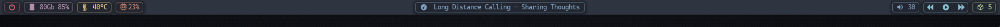

# yambar-wl

Панель для Wayland-композиторов (labwc, sway, river, niri…): форк [yambar](https://codeberg.org/dnkl/yambar),
только Wayland, без X11, D-Bus, systemd/elogind и xdg-desktop-portal.



Оригинал заброшен автором (последний коммит `abeffbd` «readme: goodbye!», май 2025), так что дальше он живёт здесь.
Его README сохранён как [README.upstream.md](README.upstream.md).

---

## Чем отличается от yambar

**Зависимости.** По умолчанию выключено всё, что тянет X11 или шину:

| Опция meson      | yambar   | yambar-wl | Почему                                                |
|------------------|----------|-----------|-------------------------------------------------------|
| `backend-x11`    | enabled  | disabled  | только Wayland                                        |
| `plugin-mpris`   | enabled  | disabled  | D-Bus через libsystemd / elogind / basu               |
| `plugin-xkb`     | auto     | disabled  | X11                                                   |
| `plugin-xwindow` | auto     | disabled  | X11                                                   |

К xdg-desktop-portal yambar не обращается вообще. Проверка после сборки:

```bash
ldd build/yambar | grep -Ei 'xcb|x11|dbus|systemd|elogind' || echo чисто
```

**Пилюли.** У декорации `background` новые параметры — скругление, отступ от краёв панели, рамка и мягкая тень:

| Параметр        | Что делает                                                        | По умолчанию |
|-----------------|-------------------------------------------------------------------|--------------|
| `radius`        | скругление углов, px (больше половины высоты — режется)           | 0            |
| `margin`        | отступ фона от верха и низа панели, px                            | 0            |
| `border-width`  | толщина рамки внутри формы, px; нужен `border-color`              | 0            |
| `border-color`  | цвет рамки, `RRGGBBAA`                                            | —            |
| `shadow-size`   | длина размытия тени вокруг формы, px; нужен `shadow-color`        | 0            |
| `shadow-color`  | цвет тени у края формы, дальше плавно до прозрачного              | —            |
| `shadow-offset` | сдвиг тени вниз, px                                               | 1            |

У `underline` — `inset`: укоротить линию на N px с обеих сторон.

Панель разрешает декорациям заходить в свои боковые поля (`bar.margin`), чтобы тень крайних пилюль не обрезалась.
Текст и значки туда как не попадали, так и не попадают.

Всё описано в `man yambar-decorations` после установки или в [doc/yambar-decorations.5.scd](doc/yambar-decorations.5.scd).

---

## Сборка и установка

Нужны пакеты (Arch / Artix):

```bash
sudo pacman -S --needed meson ninja scdoc tllist fcft pixman libyaml wayland wayland-protocols flex bison
# по желанию, для модулей: alsa-lib libmpdclient libpulse pipewire json-c
```

Сборка и установка в `~/.local/bin`, без root:

```bash
git clone https://github.com/b0ris8/yambar-wl.git
cd yambar-wl
meson setup build --buildtype=release --wrap-mode=nofallback
ninja -C build
install -m755 build/yambar ~/.local/bin/
```

Бинарник называется `yambar`, конфиг — `~/.config/yambar/config.yml`, как у оригинала.
Если в системе остался пакетный yambar, запускайте по полному пути `~/.local/bin/yambar`
или удалите пакет: `sudo pacman -R yambar`.

Обновить после изменений в коде:

```bash
git pull
ninja -C build && install -m755 build/yambar ~/.local/bin/
```

Если папку репозитория переносили — сначала `rm -rf build` и заново `meson setup`: build хранит абсолютные пути.

---

## Конфиг

Готовый пример в стиле пилюль (Nord + тёмные `#232731` / `#16191f`): [examples/configurations/pill.yml](examples/configurations/pill.yml).

```bash
cp examples/configurations/pill.yml ~/.config/yambar/config.yml
~/.local/bin/yambar --validate
```

Основа — фон с рамкой и тенью вешается на весь `list`, а не на каждую строку, тогда пилюля одна на модуль:

```yaml
pill_bg: &pill_bg 232731ff
pill_shadow: &pill_shadow 16191fff
pill_cyan: &pill_cyan
  background: {color: *pill_bg, radius: 5, margin: 4, border-width: 1, border-color: 88c0d080,
               shadow-size: 8, shadow-color: *pill_shadow}

bar:
  height: 28        # пилюля = height - 2*margin
  margin: 8         # боковые поля под тень крайних пилюль (>= shadow-size)
  spacing: 4        # промежуток между пилюлями = 2*spacing
  ...
  right:
    - cpu:
        content:
          map:
            conditions:
              id == -1:
                list:
                  left-margin: 8
                  right-margin: 8
                  deco: *pill_cyan
                  items:
                    - string: {text: "{cpu}%"}
```

Что крутить:

| Хочу                              | Где                                                     |
|-----------------------------------|---------------------------------------------------------|
| скругление больше / меньше        | `radius`; 0 — прямые углы, половина высоты — капсула     |
| пилюля ниже / выше                | `bar.height` и `margin`                                 |
| рамка ярче / тише                 | альфа в `border-color`: `...80` — 50%, `...cc` — 80%    |
| тень длиннее / короче             | `shadow-size`; `bar.margin` не меньше                    |
| тень плотнее / светлее            | цвет `shadow-color`                                     |
| отступ текста внутри пилюли       | `left-margin` / `right-margin` у `list`                 |

Стоковый yambar на этих ключах откажется стартовать (`invalid key: radius`) — значит, запустился не тот бинарник.

<details>
<summary>Полный конфиг со скриншота — <code>examples/configurations/pill.yml</code></summary>

Значки — Nerd Fonts (Symbols Nerd Font), текст — Cascadia Code. Модули `script` ждут свои скрипты
`~/.config/yambar/sensors.sh` и `checkupdates.sh` — замените на свои или уберите.

```yaml
# ~/.config/yambar/config.yml — стиль «пилюли» (Nord + свои тёмные)
# ТРЕБУЕТ пропатченный yambar (ветка pill): background.radius / margin / border-* / shadow-*.
# Стоковый yambar на этих ключах откажется стартовать.

icon_font: &icon_font 'Symbols Nerd Font:pixelsize=14'

# Polar Night: nord0 2e3440, nord1 3b4252, nord2 434c5e, nord3 4c566a
# + свои тёмные: 232731, 1d2129
pill_bg: &pill_bg 232731ff

# Форма пилюли: radius — скругление углов, margin — отступ от верха/низа панели,
# пилюля = height - 2*margin. Рамка пилюли — цветом модуля (pill_<цвет>),
# у нейтральной пилюли (pill) — pill_border.
pill_shadow: &pill_shadow 16191f99   # тень пилюли: 16191f, 60% у рамки, плавно к нулю за shadow-size
pill_border: &pill_border 3b425280   # nord1, 50% — рамка нейтральной пилюли
pill_shape: &pill_shape {color: *pill_bg, radius: 5, margin: 4, border-width: 1, shadow-size: 8, shadow-color: *pill_shadow, border-color: *pill_border}
pill:       &pill       {background: *pill_shape}
pill_red:  &pill_red  {background: {color: *pill_bg, radius: 5, margin: 4, border-width: 1, shadow-size: 8, shadow-color: *pill_shadow, border-color: bf616a80}}
pill_purple:  &pill_purple  {background: {color: *pill_bg, radius: 5, margin: 4, border-width: 1, shadow-size: 8, shadow-color: *pill_shadow, border-color: b48ead80}}
pill_yellow:  &pill_yellow  {background: {color: *pill_bg, radius: 5, margin: 4, border-width: 1, shadow-size: 8, shadow-color: *pill_shadow, border-color: ebcb8b80}}
pill_orange:  &pill_orange  {background: {color: *pill_bg, radius: 5, margin: 4, border-width: 1, shadow-size: 8, shadow-color: *pill_shadow, border-color: d0877080}}
pill_blue:  &pill_blue  {background: {color: *pill_bg, radius: 5, margin: 4, border-width: 1, shadow-size: 8, shadow-color: *pill_shadow, border-color: 81a1c180}}
pill_cyan:  &pill_cyan  {background: {color: *pill_bg, radius: 5, margin: 4, border-width: 1, shadow-size: 8, shadow-color: *pill_shadow, border-color: 88c0d080}}
pill_green:  &pill_green  {background: {color: *pill_bg, radius: 5, margin: 4, border-width: 1, shadow-size: 8, shadow-color: *pill_shadow, border-color: a3be8c80}}

bar:
  background: 2e3440ff        # nord0
  foreground: d8dee9ff        # nord4
  font: 'cascadia code:pixelsize=13'   # текст; значки — icon_font

  location: top
  height: 28                  # пилюля 20 + отступы 4+4; тень выходит за них и обрезается краем панели
  border:
    bottom-width: 1           # линия под панелью вместо тени
    color: 1d2129ff
  margin: 8                   # слева/справа: место для тени крайних пилюль (= shadow-size)
  spacing: 4                  # промежуток между пилюлями = 2 × spacing
  layer: bottom

  left:
    # ---- питание: ПКМ — выключить, СКМ — перезагрузить
    - label:
        content:
          list:
            spacing: 0
            left-margin: 8
            right-margin: 8
            deco: *pill_red
            on-click:
              right: sudo poweroff
              middle: sudo reboot
            items:
              - string: {text: "", font: *icon_font, foreground: bf616aff}

    # ---- память
    - mem:
        poll-interval: 2000
        content:
          list:
            spacing: 4
            left-margin: 8
            right-margin: 8
            deco: *pill_purple
            on-click:
              left: qps
              middle: wezterm -e htop
            items:
              - string: {text: "", font: *icon_font}
              - string: {text: "{used:gib}Gb {percent_used}%"}
        foreground: b48eadff

    # ---- температура (continuous, sysfs напрямую)
    - script:
        path: ~/.config/yambar/sensors.sh
        content:
          list:
            spacing: 4
            left-margin: 8
            right-margin: 8
            deco: *pill_yellow
            on-click:
              left: qps
              middle: wezterm -e htop
            items:
              - string: {text: "", font: *icon_font}
              - string: {text: "{temp}°C"}
        foreground: ebcb8bff

    # ---- процессор (id == -1 — суммарно по всем ядрам)
    - cpu:
        poll-interval: 2000
        content:
          map:
            conditions:
              id == -1:
                list:
                  spacing: 4
                  left-margin: 8
                  right-margin: 8
                  deco: *pill_orange
                  on-click:
                    left: qps
                    middle: wezterm -e htop
                  items:
                    - string: {text: "", font: *icon_font}
                    - string: {text: "{cpu}%"}
        foreground: d08770ff

  center:
    # ---- что играет
    - mpd:
        host: /run/user/1000/mpd/socket
        content:
          list:
            spacing: 6
            left-margin: 10
            right-margin: 10
            deco: *pill_blue
            items:
              - string: {text: "", font: *icon_font}
              - string: {text: "{artist} - {title}"}
        foreground: 81a1c1ff

  right:
    # ---- громкость mpd
    - mpd:
        host: /run/user/1000/mpd/socket
        content:
          list:
            spacing: 4
            left-margin: 8
            right-margin: 8
            deco: *pill_blue
            items:
              - string: {text: "墳", font: *icon_font}
              - string: {text: "{volume}"}
        foreground: 81a1c1ff
    ##- pulse:
    ##    content:
    ##      string: {text: "{sink_percent}% ({sink_port})"}

    # ---- управление плеером: одна пилюля на три кнопки
    - label:
        content:
          list:
            spacing: 8
            left-margin: 6
            right-margin: 6
            deco: *pill_cyan
            items:
              - string:
                  text: ""
                  font: *icon_font
                  foreground: 88c0d0ff
                  on-click: mpc prev
              - string:
                  text: ""
                  font: *icon_font
                  foreground: 88c0d0ff
                  on-click:
                    left: mpc toggle
                    middle: /home/admin/.local/bin/unrated-playlist-gen
                    right: cantata
                    wheel-up: mpc volume +5
                    wheel-down: mpc volume -5
              - string:
                  text: ""
                  font: *icon_font
                  foreground: 88c0d0ff
                  on-click: mpc next

    # ---- обновления: значок + счётчик в одной пилюле
    - script:
        path: ~/.config/yambar/checkupdates.sh   # continuous: раз в час + SIGUSR1
        content:
          map:
            on-click:
              left: sh -c 'wezterm -e yay; pkill -USR1 -f yambar/checkupdates.sh'
              right: pkill -USR1 -f yambar/checkupdates.sh
            default:
              list:
                spacing: 4
                left-margin: 8
                right-margin: 8
                deco: *pill
                items:
                  - string: {text: "", font: *icon_font, foreground: a3be8c80}
                  - string: {text: "0", foreground: a3be8c80}
            conditions:
              ~ok:
                list:
                  spacing: 4
                  left-margin: 8
                  right-margin: 8
                  deco: *pill_red
                  items:
                    - string: {text: "", font: *icon_font, foreground: bf616aff}
                    - string: {text: "{updates}?", foreground: bf616aff}
              updates > 0:
                list:
                  spacing: 4
                  left-margin: 8
                  right-margin: 8
                  deco: *pill_green
                  items:
                    - string: {text: "", font: *icon_font, foreground: a3be8cff}
                    - string: {text: "{updates}", foreground: a3be8cff}

# Подгонка (только якоря наверху):
#   скругление            -> pill_shape.radius (0 = прямые углы, 10 = полная «капсула» при пилюле 20)
#   высота пилюли         -> bar.height и pill_shape.margin (пилюля = height - 2*margin)
#   рамка пилюли          -> border-width / border-color в pill_<цвет> (сейчас 50%: ...80; плотнее: ...cc)
#   линия под панелью     -> bar.border (bottom-width: 0 = убрать)
#   тень                  -> shadow-size (длина размытия, 0 = без тени; bar.margin не меньше) и pill_shadow (цвет)
#   размер текста         -> bar.font pixelsize; размер значков -> icon_font
#   отступ текста внутри  -> left-margin / right-margin у list
```

</details>

---

## Запуск

В `~/.config/labwc/autostart`:

```sh
"$HOME/.local/bin/yambar" &
```

Перезапуск из любого места с dbus-окружением сессии labwc — скрипты `yambar-restart` и `restart-desktop-apps`
(в репозитории `infra`); в них тоже полный путь `$HOME/.local/bin/yambar`.

---

## Происхождение и лицензия

Форк [dnkl/yambar](https://codeberg.org/dnkl/yambar) с коммита `abeffbd`, удалёнка `upstream`.
Лицензия MIT, как у оригинала — [LICENSE](LICENSE).
